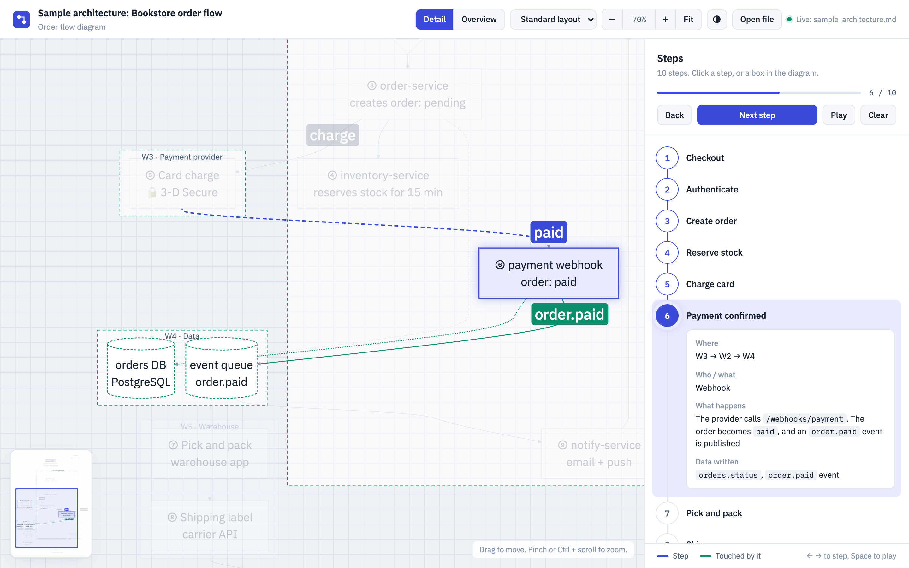
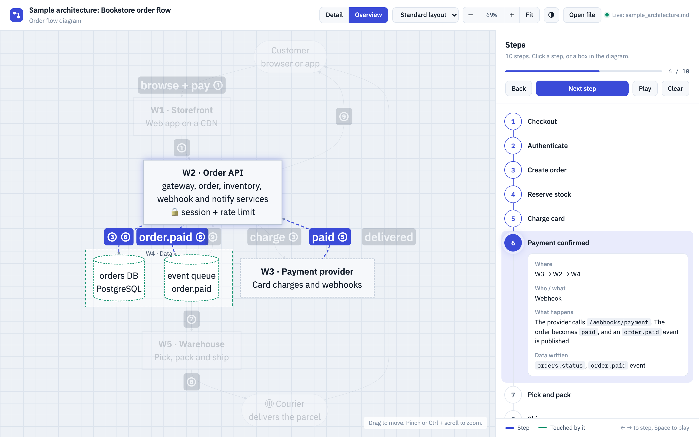
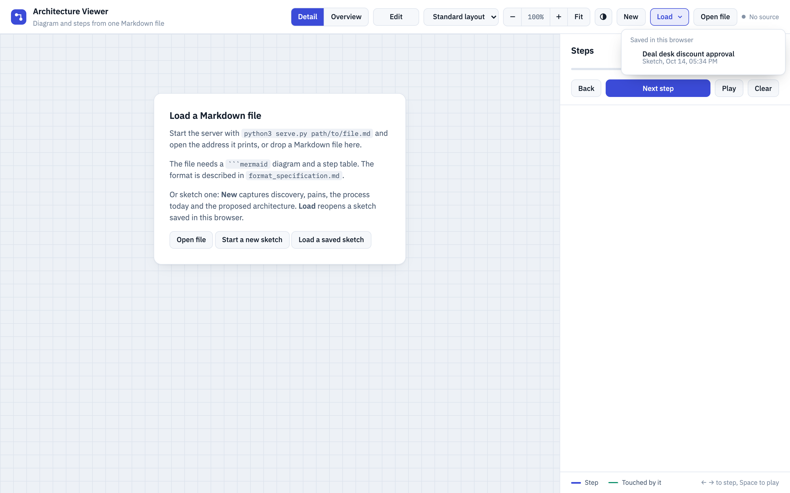
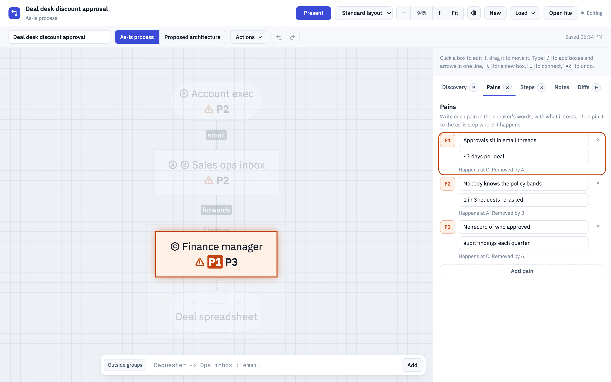
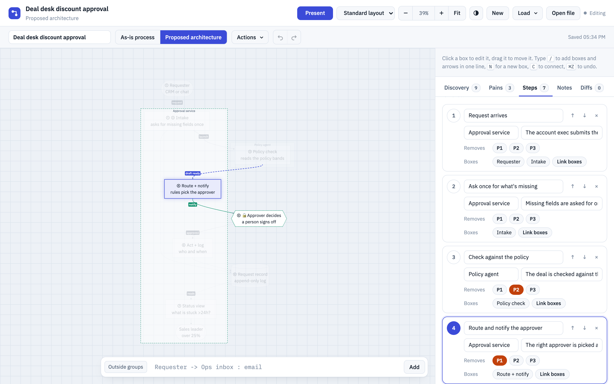
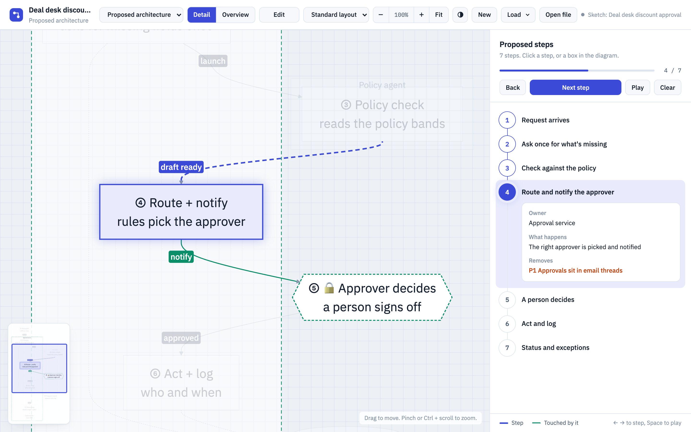

# Mermaid Architecture Viewer

An interactive walkthrough of a Mermaid flowchart and its step table, both from one Markdown file. Use it to present a process step by step in a demo.

- **Click a step** in the sidebar (or press ← / →, or Play). The view zooms to the step and highlights its boxes and arrows, plus what it touches.
- **Click a box or group** in the diagram to see every step that uses it.
- **Overview** (or `O`) collapses each group (environment) into one box and merges the arrows between groups, for presenting the overall architecture. Steps still work there. **Detail** goes back to every box. See section 6 of `format_specification.md`.
- **Fit** (or `F`) shows the whole diagram. The minimap in the corner shows where you are: click or drag in it to move.
- **Compact layout** (dropdown) uses Mermaid's ELK layout engine: a smaller diagram with right-angled arrows. The choice is remembered per browser.
- **Edit the Markdown file** while the server runs, and the page updates within about 2 seconds.
- **New**, **Load** and **Open file** (top bar, also on the start page) start a sketch, reopen one saved in this browser, or open a Markdown file.
- **Edit** (top bar) edits what is shown, or sketches a new process live: discovery notes, pains, an as-is and a proposed architecture diagram, each with its own steps. Every change saves in the browser and goes into a diff log. **Export .md** writes a file in this viewer's format. **Present** switches back. See [Edit mode](#edit-mode).





*Both screenshots show `sample_architecture.md`, a fictional bookstore order flow, at step ⑥ "Payment confirmed". Top: **Detail**. Bottom: **Overview**.*

## Run

```bash
cd architecture_viewer
python3 serve.py sample_architecture.md --open   # the bundled sample
python3 serve.py sample_sketch.md --open         # a sketch made in Edit mode
python3 serve.py                      # ../architecture.md, or the sample if that file doesn't exist
python3 serve.py path/to/other.md --port 8001 --open
```

Then open http://127.0.0.1:8000/. The server binds to localhost only and serves just the page and that one file. Python 3.10+ standard library, nothing to install.

Without the server, open `index.html` in a browser and drop a Markdown file onto it. That works without live reload.

The page loads Mermaid 11 (and, for the compact layout, its ELK plugin) from cdn.jsdelivr.net and IBM Plex fonts from Google Fonts, so it needs internet access.

## Edit mode

One button in the top bar switches between **Edit** and **Present**. In Present it reads **Edit**, and in Edit it reads **Present**.

**What Edit opens**
- **A file shown in the viewer** (served, opened or dropped): Edit opens a **copy** of it. Each diagram that has a step table becomes a board, and you edit its boxes, arrows, groups and table rows. The file itself is never changed.
  - The copy is saved in the browser.
  - Its export puts the edited diagrams and tables back into the file's text, in place. Lines you didn't touch stay exactly as they were, and everything else in the file is kept.
  - Right after opening, the viewer draws the file's diagram and the editable copy and compares them. If they differ in boxes, groups, arrows or labels, it says so before you edit.
  - If you already have a copy of the same file, Edit asks whether to continue with it or start a new copy.
- **A file exported from Edit mode:** Edit reopens the sketch stored in it, including its diff log.
  - If the browser has newer changes to that sketch, you choose which version to keep.
  - If the file was changed by hand after the export, you choose between the file as it is now and the exported sketch.
- **New** (top bar, also on the start page) starts an empty sketch in Edit mode.
- **Load** (top bar, also on the start page) lists every sketch saved in this browser, newest first, and opens the one you pick in Edit mode.
- **Open file** (top bar) opens a Markdown file. In Present mode it is shown; in Edit mode it is edited.

Use it for a live discovery session: ask, note the pains, map the process as it runs today, then sketch the proposed architecture that removes the pains.

### Walkthrough: from discovery to the proposed architecture

The screenshots show a synthesized sample, **Deal desk discount approval**: account execs ask for discounts by email, and Finance decides in the thread. It is bundled as `sample_sketch.md`. Serve or open it, and click **Edit** to explore it in Edit mode, or follow the steps below to build your own.

**1. Start.** The start page and the top bar offer three ways in:
- **Start a new sketch** (or **New**) opens an empty sketch in Edit mode.
- **Load a saved sketch** (or **Load ▾**) lists the sketches saved in this browser. Pick one to continue it in Edit mode.
- **Open file** opens a Markdown file. In Present mode it is shown; in Edit mode it is edited.



**2. Capture the pains and map the process today.**
- Give the sketch a name in the second bar, and fill in **Discovery** as you ask.
- In **Pains**, write each pain in the speaker's words, with what it costs.
- On the **As-is process** board, draw the boxes: type `Account exec -> Sales ops inbox : email` in the bar at the bottom, or right-click the canvas.
- In **Steps**, add the steps, **Link boxes** for each one, and tag the pains that happen there. A tagged box shows `⚠ P1` in orange.
- **Click a pain** in the Pains tab (its token, or anywhere in its row) to highlight where it happens: the boxes of the steps tagged with it, and its tag in the box label. Click it again, click the canvas, or press `Esc` to clear.



**3. Sketch the proposed architecture.**
- Switch to **Proposed architecture** in the second bar. Each board has its **own diagram and its own steps**; Discovery and Pains are shared.
- Draw it, or start an empty board from **Start from the standard pattern** and rename the boxes and groups.
- Each proposed step has an **owner** (free text: a team, a system or a person), what happens, and the pains it **removes**.
- The **Pain check** below the steps lists pains that no step removes yet.



**4. Present.**
- Click **Present**. The sketch shows on the board that was open, with its steps to click through, and the picker in the top bar switches between **As-is process** and **Proposed architecture**, each with its own steps.
- Pains and the pains a step removes are shown in orange in the step details.
- A board shows in Present even before it has steps: the steps pane then says so.
- **Edit** goes back. **Actions → Export .md** saves everything as one Markdown file.



**Sidebar tabs**
- **Discovery:** a form for a solutions architect's technical discovery, in collapsible sections:
  - use case
  - current process
  - pains
  - quantification
  - blockers and risks
  - definition of success
  - decision process
  - rollout plan
  - open questions

  Each section shows how many of its fields are filled.
- **Pains:** P1, P2 … in the speaker's words, with what each one costs. Each pain says where it happens and which proposed step removes it. Click a pain to highlight it in the diagram.
- **Steps:** the steps of the board that is open. Switching the board switches the steps. Selecting a step highlights the same boxes and arrows as in Present mode. While **Link boxes** is on, only the linked boxes are highlighted, so each click shows its effect.
  - **As-is** steps (Ⓐ Ⓑ Ⓒ) have who, tool, wait, and the pains that happen there.
  - **Proposed architecture** steps (① ② ③) have an owner (free text: a team, a system or a person), what happens, and the pains they remove.
  - **Link boxes** connects a step to its boxes. The step key then appears in the box label.
  - The **Pain check** under the proposed steps lists pains that no step removes, and steps that remove no pain. It also has a scorecard with a pilot measure per pain.
- **Notes:** free text.
- **Diffs:** the diff log, newest first. Every change is one entry: a run of typing in one field, an added box, a drag, an undo, a restore. Each entry says what changed in plain words.
  - **Select an entry** to show that state on the canvas, read-only, with what changed in that step.
  - **Restore this state** makes it the current state. The restore is itself a new entry and can be undone, so no state is ever lost.
  - **Back to now**, or `Esc`, leaves the preview.

**File boards** (from an opened file) keep the file's own step keys and columns. The Steps tab edits every cell of the table, and each step can be tagged with pains from the Pains tab. When a step has pains, the table gets a **Pains** column at the end, so Present and the export show them with each step. The file's own cells are kept as they are. The Pain check is only on sketch boards.

**Drawing.** Mermaid lays out the boxes. **Drag** a box to move it, or drag a group by its title to move it with everything in it. Dragging anywhere else, including the inside of a group, moves the diagram. In Edit mode the **scroll wheel zooms** at the pointer. A moved box is pinned: it keeps its place, its arrows are drawn straight to it, and its group grows or shrinks to fit. **Reset positions** in the Actions menu, or **Reset position** in a box's right-click menu, hands the layout back to Mermaid. Changing a board's direction also resets its positions.
- **Quick-add bar** at the bottom of the canvas (press `/`):
  - `Requester -> Ops inbox : email` adds both boxes and a labelled arrow.
  - `A -> B -> C` chains boxes.
  - `..>` draws a dashed arrow.
  - `[Finance]` puts that line's new boxes into that group. Without it, new boxes go outside any group.
  - `person:`, `store:`, `decision:` or `gate:` in front of a name sets its shape.
- **Right-click** the canvas. New boxes go outside any group, except when you add them from a group's menu:
  - **empty space:** add a shape or a group
  - **a group:** add a shape inside it
  - **a box:** add a shape connected from it, draw an arrow, rename or delete
- **Actions menu** (second bar), with four sections:
  - **Add:** a shape (box, person, system of record, decision, human gate), a group, or Connect (click the start box, then the end box).
  - **Layout:** the board's direction, and Reset positions. **Auto direction** keeps whichever of left-to-right or top-down fits the screen better. The first drag fixes the board's direction at whatever it is then.
  - **Share:** Copy Markdown and Export .md.
  - **Delete this sketch** (or **this copy**), after a confirmation. A copy's file is not affected.

  `N` adds another box of the last shape you picked.
- **Editing a box:** click it to edit its name, its further lines, its shape, its group and its arrows in the sidebar. Double-click it to rename.
- **Starting the proposed architecture board:** on an empty board, **Start from the standard pattern** fills in front door, intake, agent work, routing, a human gate, act and log, and status, in a Platform and an Agent group. Rename the boxes and groups to fit.

**Saving.** Every change saves in the browser's local storage within a second, and survives reloads and restarts. Undo and redo (`⌘Z`, `⇧⌘Z`) go back up to 50 steps, and the diff log keeps everything.
- **Separate entries:** each sketch is its own storage entry, and a save writes only that entry, so one sketch can't overwrite another.
- **Two tabs:** when another tab saves newer changes to the open sketch, this tab takes them over instead of overwriting them.
- **Checks on opening:** a sketch that can't be read is listed as damaged and never opened or replaced. A diff log that doesn't lead to the saved state is restarted instead of being trusted.
- **One address:** `127.0.0.1:8000` and `localhost:8000`, or another port, each have their own sketches.
- **Clearing site data** deletes them. **Export .md** is the backup.

**Export and present**
- **Export .md** (Actions menu) downloads the sketch as a Markdown file in this viewer's format. For a copy of a file, the name is `<file>-edited.md`. The export holds:
  - the discovery and the pains, when filled in
  - one diagram and one step table per board. For a copy, these are the file's text with the edits in place.
  - a pain scorecard, for sketches
  - a **Diffs** section with every change, in plain words
  - the sketch itself, with its full diff log, in an HTML comment, so opening the file and clicking **Edit** brings it all back
- **Copy Markdown** puts the same text on the clipboard.
- **Present** leaves Edit mode and shows the sketch in the viewer, with Detail, Overview and the steps to click through. A board without steps is still drawn.

| Key (Edit mode) | Action |
|---|---|
| / | Jump to the quick-add bar |
| N | New box, in the last shape you picked |
| G | New group |
| C | Connect two boxes |
| Enter | Rename the selected box |
| Delete | Delete the selected box or group |
| Esc | Leave a Diffs preview, cancel connecting or linking, then clear the selection |
| ⌘Z / ⇧⌘Z | Undo / redo |

## Files

| File | Purpose |
|---|---|
| `index.html` | The whole app: parser, linking, rendering, UI, Edit mode |
| `serve.py` | Local server: `/` (page), `/api/source` (file text), `/api/mtime` (change polling) |
| `format_specification.md` | How to write a compatible file, for people and AI agents: walkthrough files for architectures, and process sketches (as-is process, pains, proposed architecture), with tested examples and a checklist |
| `sample_architecture.md` | A fictional sample (bookstore order flow) to try the viewer |
| `sample_sketch.md` | A sketch exported from Edit mode (deal desk discount approval, synthesized): discovery, pains, both boards with their steps, and the pain scorecard. **Edit** reopens it as a sketch |
| `screenshots/` | Detail and overview of the bookstore sample; the start page, Edit mode (pains, proposed architecture) and Present mode of the deal desk sketch |
| `LICENSE`, `NOTICE` | Apache License 2.0 and the attribution notice |

## Keys

| Key | Action |
|---|---|
| → / ↓ | Next step |
| ← / ↑ | Previous step |
| Space | Play or pause (3 s per step) |
| Esc | Clear the highlight |
| O | Switch between Detail and Overview |
| F | Fit the whole diagram |
| + / − | Zoom in or out |
| Drag | Move the diagram |
| Pinch, or Ctrl/Cmd + scroll | Zoom at the pointer |
| Scroll | Move the diagram |

## License

Copyright 2026 Moritz Foerster. Licensed under the [Apache License 2.0](LICENSE): free to use, change and redistribute. Copies and derived works must keep the license and the attribution in [NOTICE](NOTICE).
