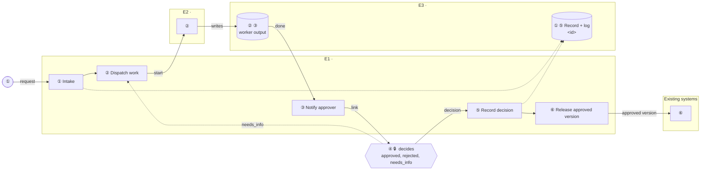

# Sketch template

Copy everything between the `BEGIN` and `END` lines into the `sketch` path that `scripts/new_project.py` returned (`projects/<id>/<slug>.md`) and replace every `<…>`. `"id":"<slug>"` in the JSON becomes the project's `id`. Leave out a discovery subsection that would be empty, and add rows as needed. The rules are in `format_specification.md` §8 and `.cursor/rules/sketch-format.mdc`.

<!-- BEGIN TEMPLATE -->
````markdown
# <Title>

Sketched in Architecture Viewer on <D Mon YYYY>. All data is synthesized for the exercise.

## Technical discovery

### Use case

- **Use case:** <usecase.name>
- **Line of business and team:** <usecase.lob>
- **Business owner:** <usecase.sponsor>
- **Users:** <usecase.users>
- **What starts it:** <usecase.trigger>
- **Why now:** <usecase.why>

### Process today

- **Summary:** <process.summary>
- **Systems:** <process.systems>
- **Handoffs:** <process.handoffs>
- **Exceptions:** <process.exceptions>

### Pains

- **Top pain:** <pains.top>
- **Impact:** <pains.impact>

### Quantification

- **Volume:** <quant.volume>
- **Cycle time today:** <quant.cycle>
- **Hands-on time per item:** <quant.touch>
- **People involved:** <quant.people>
- **Rework and exception rate:** <quant.rework>
- **Cost:** <quant.cost>

### Blockers

- **Security:** <blockers.security>
- **Data:** <blockers.data>
- **Integrations:** <blockers.integrations>
- **Change:** <blockers.change>

### Definition of success

- **Success metric:** <success.kpi>
- **Baseline:** <success.baseline>
- **Target:** <success.target>
- **Done when:** <success.done>
- **Guardrails:** <success.guardrails>

### Decision process

- **Economic buyer:** <decision.buyer>
- **Technical decision maker:** <decision.tech>
- **Champion:** <decision.champion>
- **Approvers:** <decision.approvers>
- **Criteria:** <decision.criteria>
- **Timeline:** <decision.timeline>

### Rollout

- **Pilot:** <rollout.pilot>
- **Duration:** <rollout.duration>
- **Measure:** <rollout.measure>
- **Go/no-go:** <rollout.gonogo>
- **Phases:** <rollout.phases>
- **Owner:** <rollout.owner>

### Next steps

- **Open questions:** <next.questions>
- **Next steps:** <next.steps>

## Pains

| Pain | # | Cost |
|---|---|---|
| <pain in the speaker's words> | P1 | <cost> |

## As-is process

```mermaid
flowchart LR
    subgraph <GROUP_ID>["<Group label>"]
        <BOX_ID>["Ⓑ <Box label><br/><detail><br/>⚠ P1"]
        <STORE_ID>[("Ⓑ <Inbox or spreadsheet>")]
    end
    <PERSON_ID>(["Ⓐ <Role>"])
    <PERSON_ID> -- "<what moves>" --> <BOX_ID>
    <BOX_ID> -.-> <STORE_ID>
    %% @overview <GROUP_ID>: <Group label> | <boxes in it>
    %% @exact Ⓐ Ⓑ
```

### As-is steps

| # | Step | Who | Tool | Wait | Pain |
|---|---|---|---|---|---|
| Ⓐ | <step> | <role> | <tool> | <wait> |  |
| Ⓑ | <step> | <role> | <tool> | <wait> | ⚠ P1 <pain text> |

## Proposed architecture



### Proposed steps

| # | Step | Owner | What happens | Removes |
|---|---|---|---|---|
| ① | <step> | <Orchestrator product> | <one sentence> | P1 <pain text> |
| ② | <step> | <Worker product> | <one sentence> |  |
| ③ | <step> | <Orchestrator product> | <one sentence> |  |
| ④ | <step> | <Approver role> | <one sentence> |  |
| ⑤ | <step> | <Orchestrator product> | <one sentence> |  |
| ⑥ | <step> | <Orchestrator product> | <one sentence> |  |

## Pain scorecard

| Pain | Fixed by | Measure |
|---|---|---|
| P1 <pain text> | Step ① <step name> | <how the pilot measures it> |

## Implementation notes

| Artifact | Contents |
|---|---|
| <Orchestrator product> | <what is built or configured, which blocks it runs> |
| <Worker product> | <…> |
| Record schema | <fields, status flow, approvals, log> |
| Credentials | <one per component, name and scope only> |
| Limits and cost | <rate limits, quotas, pricing unit at the customer's volume> |
| Sources | <main official documentation pages, see stack-notes.md> |

<!-- architecture-viewer-sketch
{"v":3,"id":"<slug>","title":"<Title>","notes":"",
 "discovery":{"usecase.name":"<…>","usecase.lob":"<…>"},
 "pains":[{"id":"P1","text":"<pain text>","cost":"<cost>","measure":"<measure>"}],
 "boards":{
  "asis":{"dir":"LR",
          "groups":[{"id":"g_<x>","label":"<Group label>","parent":null}],
          "nodes":[{"id":"n_<x>","label":"<Box label>","sub":"<detail>","shape":"box","group":"g_<x>"},
                   {"id":"n_<y>","label":"<Role>","shape":"person"}],
          "edges":[{"id":"e1","from":"n_<y>","to":"n_<x>","label":"<what moves>","dashed":false}],
          "steps":[{"name":"<step>","who":"<role>","tool":"<tool>","wait":"<wait>","pains":[],"nodes":["n_<y>"]},
                   {"name":"<step>","who":"<role>","tool":"<tool>","wait":"<wait>","pains":["P1"],"nodes":["n_<x>"]}]},
  "tobe":{"dir":"LR",
          "groups":[{"id":"E1","label":"E1 · <Orchestrator product>","parent":null},{"id":"E2","label":"E2 · <Worker product>","parent":null},
                    {"id":"E3","label":"E3 · <System of record product>","parent":null},{"id":"EXT","label":"Existing systems","parent":null}],
          "nodes":[{"id":"intake","label":"Intake","sub":"<feature or endpoint>","shape":"box","group":"E1"}],
          "edges":[{"id":"t1","from":"requester","to":"intake","label":"request","dashed":false}],
          "steps":[{"name":"<step>","owner":"<Orchestrator product>","what":"<one sentence>","pains":["P1"],"nodes":["requester","intake"]}]}}}
-->
````
<!-- END TEMPLATE -->

## Notes on the template

- The JSON is shown with placeholders. Write real JSON: every `<…>` replaced, no trailing commas, one node per box in the diagram, one edge per arrow, one step per table row, in the same order.
- Keep `--` out of labels altogether (write `import create`, not `import --create`), because Mermaid can read `--` as an arrow. If a `--` must appear anywhere in the JSON (notes, discovery answers), write it as `-\u002d`.
- An edge listed in a step's `edges` needs an `id`. Giving every edge an `id` is simplest.
- The proposed board above is the smallest useful shape, with placeholder roles. Replace every `<… product>` with the component `stack-notes.md` maps to that role, merge or split environments to match the real stack, and add the blocks the process needs (validate, route, monitor, rework, status) from `architecture-pattern.md` §2.
- `E1`, `E2`, `E3` are numbered in the order the main path first reaches them. A stack with one platform for orchestration and records can have fewer groups; one with several services can have more.
