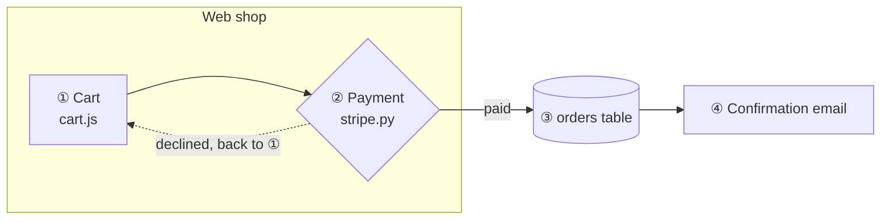

# Source file format for the Architecture Viewer

This spec describes the Markdown file that `index.html` reads (through `serve.py`, a file picker or drag and drop). It is written for people and for AI coding assistants who want to produce a compatible file.

**In one sentence:** one Markdown file holds a Mermaid **flowchart** and a Markdown **step table**. Each table row has a short **step key**, and the same key appears in the label of the diagram boxes that belong to that step.

---

## 1. File structure

A UTF-8 Markdown file (`.md`) that contains at least:

1. **A diagram:** a fenced code block with the info string `mermaid` that contains a `flowchart` (or `graph`) diagram.
2. **A step table:** a GitHub-flavoured Markdown table with one column of step keys.

Everything else in the file (prose, other tables, other code blocks) is allowed and ignored.

| Element | Used for |
|---|---|
| First `# H1` heading | Page title |
| Nearest heading above the diagram | Subtitle |
| Nearest heading above the step table | Title of the step list |

If the file contains several diagrams or tables, the viewer picks the diagram, table and key column that match best (section 4), and it shows dropdowns to switch between them.

## 2. The diagram

- **Type:** `flowchart TD`, `flowchart LR` or `graph …`. Only flowcharts are supported, because the viewer reads the flowchart's node, edge and subgraph ids from the rendered SVG. Mermaid 11 does the rendering.
- **Nodes:** any flowchart shape (`A["…"]`, `A{"…"}`, `A[("…")]`, `A(["…"])` and so on). The node **id** (`A`) is what overrides refer to (section 5). Ids may contain letters, digits and `_`.
- **Subgraphs** (`subgraph E1["…"] … end`) become clickable groups. A node belongs to the smallest subgraph that contains it on screen.
- **Edges:** any arrow (`-->`, `-.->`, `==>`). Labels (`-- text -->` or `-->|text|`) are searched for step keys too. Dotted edges are treated as side paths.
- **Line breaks** in labels: use `<br/>`. The **first line** of a label is its name in the sidebar.

### Step keys inside the diagram

Put the step key in the label of every node (or edge) that **is** that step, usually at the start:

```
LAUNCH["⑧ launch_agent.py --launch"]
```

- A key matches only as a whole token. `⑫` does not match inside `⑫a`, and `1` does not match inside `10`.
- A range of circled numbers in a label, such as `④-⑧`, is read as `④ ⑤ ⑥ ⑦ ⑧`. That's useful for one edge that stands for several steps.
- A node may carry several keys (`"③ ④ check"`), and several nodes may share one key.

## 3. The step table

```markdown
| Step | Key | Environment | Command | … any further columns … |
|---|---|---|---|---|
| Request arrives | ① | E1 | `[Requester] …` | … |
```

- **Key column:** short values without spaces, at most 6 characters each. Examples: `①`, `⑫a`, `Ⓢ`, `3`, `3a`, `S2`. Circled numbers `⓪`-`⑳` are recommended, because they stand out in the diagram and can't be confused with numbers in ordinary text. The column can sit anywhere and have any header.
- **Name column:** the first column that isn't the key column. It's shown as the step title.
- **All other columns** are shown, under their header, in the detail panel of the selected step. Inline `code` and `**bold**` are rendered.
- **Row order is the step order** for Next, Back and Play. Keys may repeat: two rows with key `⑫` both highlight the `⑫` boxes.
- A `|` inside a cell must be inside backticks or escaped as `\|`.

## 4. How the table is matched to the diagram

For every combination of diagram, table and column, the viewer collects the cells that are valid keys (section 3) and also appear in the diagram source. The score is:

> **number of distinct matching keys × share of the table's rows that match**

The highest score wins, and **at least 2 distinct keys** must match. Real step keys are distinct, and almost every row matches. A column such as "Environment" repeats the same value (`E1`, `E1`, …) and matches only some rows, so it scores low even when `E1` appears in the diagram. If a file has several diagrams, each diagram picks its own best table when you switch to it, so give each diagram its own key set (for example ①-⑭ for one, Ⓐ Ⓑ Ⓒ for another).

## 5. What a step highlights

| Highlight | Colour in the UI | Elements |
|---|---|---|
| **Step** (primary) | Signal blue, animated edges | Nodes whose label contains the key. Nodes listed for the key in a `%% @step` override. Edges whose label contains the key. Edges between two step nodes. Edges from the previous step's nodes to this step's nodes. |
| **Touched** (secondary) | Green, dashed | Nodes one edge away (in or out) from a step node. The endpoints of edges labelled with the key. The subgraph around each step node. Nodes and subgraphs **mentioned** in the row's text (below). |

**A row mentions a node or subgraph when its text contains:**
- the node **id** as a whole word, case-sensitive and at least 2 characters (for example `E1`, `PR`)
- a file, path or endpoint token from the node's label (a word with `.` or `/`, such as `check_sender.py` or `/v1/agents`), as long as at most two nodes share that token
- the node's **short name**: the first label line, cut at `(`, `,` or `:`, between 4 and 30 characters and at most 3 words, matched as a whole phrase in any case (for example `Requester`)

**Clicking a node or subgraph** lists every step for which it is a step or touched element, and highlights those rows.

### Overrides

If the automatic linking misses something, add Mermaid comments. Mermaid ignores them, and the viewer reads them:

```
%% @step ⑨: API, AGENT
%% @step ⑫a: FOLLOW API
```

Syntax: `%% @step <key>: <node or subgraph id>, <id> …`, with ids separated by commas or spaces. Listed ids become **step** (primary) elements for that key. Unknown ids are ignored.

## 6. Minimal example

````markdown
# Order flow

## Diagram



## Steps

| Step | # | Where | What happens |
|---|---|---|---|
| Add to cart | ① | WEB | `cart.js` stores the items |
| Pay | ② | WEB | `stripe.py` charges the card |
| Save order | ③ | DB | Row written to the orders table |
| Confirm | ④ | Mail | Email sent to the customer |
````

## 7. Checklist for authors and assistants

- [ ] There is exactly one `mermaid` block with a `flowchart`, or the right one is selected in the dropdown.
- [ ] Every table row has a key, and that key appears in at least one node or edge label (or in a `%% @step` line).
- [ ] Keys are whole tokens: don't glue them to letters or digits unless that's the key itself (`⑫a`).
- [ ] No other table column contains short tokens that also appear in the diagram, or that column may be picked as the key column instead.
- [ ] Node ids that you want rows to mention (such as environments `E1`, `E2`) appear as whole words in the row text.
- [ ] The diagram renders in Mermaid 11 (check it at mermaid.live). Syntax errors are shown in the viewer.
