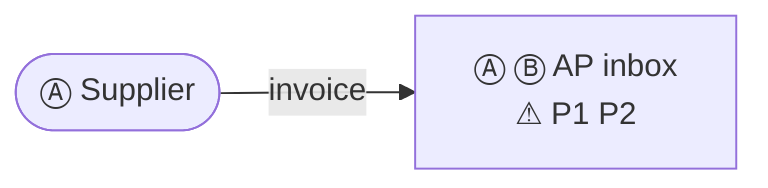
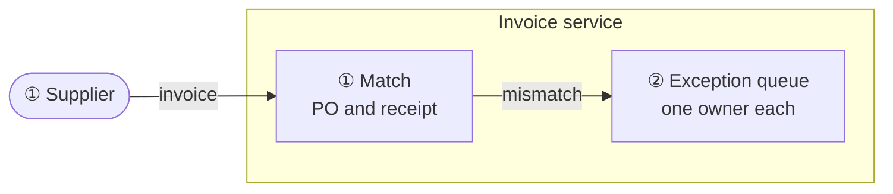
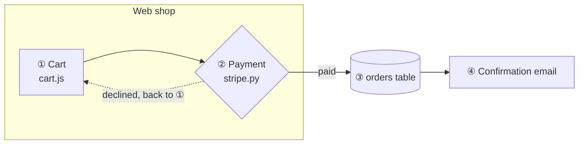

# Source file format for the Architecture Viewer

This spec describes the Markdown file that `index.html` reads (through `serve.py`, a file picker or drag and drop). It is written for people and for AI agents that create architecture diagrams or map processes for the viewer.

**In one sentence:** one Markdown file holds a Mermaid **flowchart** and a Markdown **step table**. Each table row has a short **step key**, and the same key appears in the label of the diagram boxes that belong to that step.

### Which kind of file to write

| Goal | Write | Sections |
|---|---|---|
| Walk through an **architecture** (a system, a pipeline, a request flow) step by step | A **walkthrough file**: one or more diagrams, each followed by its step table | 1-7, example in 9 |
| **Map a process**: the process today, its pains, and a proposed architecture that removes them | A **process sketch**: the Markdown of 8.1 plus the sketch as JSON (8.2), so Edit mode also opens the discovery, the pains and the owners | 8, example in 8.4 |

Both open in Present mode. In Edit mode, a walkthrough file opens as an editable copy, and a process sketch opens as itself. Check the result with section 10.

---

## 1. File structure

A UTF-8 Markdown file (`.md`) that contains at least:

1. **A diagram:** a fenced code block with the info string `mermaid` that contains a `flowchart` (or `graph`) diagram.
2. **A step table:** a GitHub-flavoured Markdown table with one column of step keys.

Everything else in the file (prose, other tables, other code blocks) is allowed and ignored.

| Element | Used for |
|---|---|
| First `# H1` heading | Page title |
| Nearest heading above the diagram | Subtitle |
| Nearest heading above the step table | Title of the step list |

If the file contains several diagrams, the viewer opens the one whose step table matches best. It pairs each diagram with its own step table (section 4), so you choose only the diagram. A dropdown for that appears when more than one diagram has a matching table. In a process sketch (section 8), every diagram is listed, also one without steps yet.

## 2. The diagram

- **Type:** `flowchart TD`, `flowchart LR` or `graph …`. Only flowcharts are supported, because the viewer reads the flowchart's node, edge and subgraph ids from the rendered SVG. Mermaid 11 does the rendering.
- **Nodes:** any flowchart shape (`A["…"]`, `A{"…"}`, `A[("…")]`, `A(["…"])` and so on). The node **id** (`A`) is what overrides refer to (section 5). Ids may contain letters, digits and `_`. Don't use Mermaid keywords such as `end`, `graph` or `subgraph` as ids.
- **Shapes with a meaning.** Edit mode names these five, and sketches use them:

  | Shape | Syntax | Use for |
  |---|---|---|
  | Box | `A["…"]` | a service, a component, a step |
  | Person | `A(["…"])` | a person or a role |
  | System of record | `A[("…")]` | a database, a log, a spreadsheet |
  | Decision | `A{"…"}` | a branch |
  | Human gate | `A{{"🔒 …"}}` | a person must approve before the flow goes on |

- **Quote labels** (`A["…"]`) whenever they contain spaces, punctuation, `(`, `)` or non-ASCII characters such as step keys.
- **Subgraphs** (`subgraph E1["…"] … end`) become clickable groups. A node belongs to the smallest subgraph that contains it on screen.
- **Edges:** any arrow (`-->`, `-.->`, `==>`). Labels (`-- text -->` or `-->|text|`) are searched for step keys too. Dotted edges are treated as side paths.
- **Line breaks** in labels: use `<br/>`. The **first line** of a label is its name in the sidebar.

### Step keys inside the diagram

Put the step key in the label of every node (or edge) that **is** that step, usually at the start:

```
LAUNCH["⑧ launch_agent.py --launch"]
```

- A key matches only as a whole token. `⑫` does not match inside `⑫a`, and `1` does not match inside `10`.
- A range of circled numbers in a label, such as `④-⑧`, is read as `④ ⑤ ⑥ ⑦ ⑧`. That's useful for one edge that stands for several steps.
- A node may carry several keys (`"③ ④ check"`), and several nodes may share one key.

## 3. The step table

```markdown
| Step | Key | Environment | Command | … any further columns … |
|---|---|---|---|---|
| Request arrives | ① | E1 | `[Requester] …` | … |
```

- **Key column:** short values without spaces, at most 6 characters each. Examples: `①`, `⑫a`, `Ⓢ`, `3`, `3a`, `S2`. Circled numbers `⓪`-`⑳` are recommended, because they stand out in the diagram and can't be confused with numbers in ordinary text. The column can sit anywhere and have any header.
- **Name column:** the first column that isn't the key column. It's shown as the step title.
- **All other columns** are shown, under their header, in the detail panel of the selected step. Inline `code` and `**bold**` are rendered.
- **Row order is the step order** for Next, Back and Play. Keys may repeat: two rows with key `⑫` both highlight the `⑫` boxes.
- A `|` inside a cell must be inside backticks or escaped as `\|`.
- **Pain columns:** in a process sketch (section 8), the columns headed `Pain`, `Removes`, `Pains` or `Pains (tagged)` are shown in orange in the step details, like the `⚠ P1` tags in the diagram. In other files they look like any other column.

## 4. How the table is matched to the diagram

For every combination of diagram, table and column, the viewer collects the cells that are valid keys (section 3) and also appear in the diagram source. The score is:

> **number of distinct matching keys × share of the table's rows that match**

The highest score wins, and **at least 2 distinct keys** must match. The one exception is a one-row table between the diagram and the next one: it is used when its single key appears in the diagram. Each diagram first scores only the tables **between it and the next diagram**. It considers the other tables only when none of those matches. So putting each step table right after its diagram is the simplest way to pair them. Real step keys are distinct, and almost every row matches. A column such as "Environment" repeats the same value (`E1`, `E1`, …) and matches only some rows, so it scores low even when `E1` appears in the diagram. If a file has several diagrams, each diagram picks its own best table when you switch to it, so give each diagram its own key set (for example ①-⑭ for one, Ⓐ Ⓑ Ⓒ for another).

## 5. What a step highlights

| Highlight | Colour in the UI | Elements |
|---|---|---|
| **Step** (primary) | Signal blue, animated edges | Nodes whose label contains the key. Nodes listed for the key in a `%% @step` override. Edges whose label contains the key. Edges between two step nodes. Edges from the previous step's nodes to this step's nodes. |
| **Touched** (secondary) | Green, dashed | Nodes one edge away (in or out) from a step node. The endpoints of edges labelled with the key. The subgraph around each step node. Nodes and subgraphs **mentioned** in the row's text (below). |

**A row mentions a node or subgraph when its text contains:**
- the node **id** as a whole word, case-sensitive and at least 2 characters (for example `E1`, `PR`)
- a file, path or endpoint token from the node's label (a word with `.` or `/`, such as `check_sender.py` or `/v1/agents`), as long as at most two nodes share that token. Bare folders ending in `/` (such as `src/`) don't count.
- the node's **short name**: the first label line, cut at `(`, `,` or `:`, between 4 and 30 characters and at most 3 words, matched as a whole phrase in any case (for example `Requester`)

**Clicking a node or subgraph** lists every step for which it is a step or touched element, and highlights those rows.

**Exact steps.** A step listed in a `%% @exact` line highlights only what is linked to it, so it shows exactly what its author chose:
- **Step:** nodes whose label contains the key, nodes and arrows listed in its `%% @step` line, arrows whose label contains the key, and arrows between two step nodes. Arrows from the previous step are not added.
- **Touched:** only the subgraph around each step node. One-hop neighbours and mentions are not added.

Every other step uses the rules in the table above. Edit mode writes `%% @exact` for every step of a process sketch, and in a copy of a file for each step whose boxes or arrows were linked or unlinked there (and for steps added there). The other steps of a copy keep the rules above, as in the original file.

### Overrides

If the automatic linking misses something, add Mermaid comments. Mermaid ignores them, and the viewer reads them:

```
%% @step ⑨: API, AGENT
%% @step ⑫a: FOLLOW API
```

Syntax: `%% @step <key>: <node or subgraph id>, <id> …`, with ids separated by commas or spaces. Listed ids become **step** (primary) elements for that key. Unknown ids are ignored.

An **arrow** is listed as `<from id>--><to id>` without spaces, for example `%% @step ④: ROUTE_NOTIFY-->APPROVER_DECIDES`. Every arrow from that node to that node becomes a step element. Edit mode writes these lines when you link arrows to a step.

```
%% @exact ③ ④
```

`%% @exact <key> <key> …` makes those steps **exact** (above): they highlight only their own nodes, the arrows between them, and the nodes and arrows in their `@step` lines. Keys are separated by spaces or commas, and several `@exact` lines add up.

## 6. Overview mode

**Overview** (button in the top bar, or the `O` key) shows the big picture: one box per group, and one arrow per pair of groups that talk to each other. The viewer computes it from the detailed diagram, so it works without extra markup. The comment lines below make it presentation-ready.

### How the overview is built

| Detailed diagram | In the overview |
|---|---|
| A **top-level `subgraph`** (for example an environment, a service or a team) | **One box**: the group's title in bold, then its role (`@overview`), or by default its number of components and its step keys. A group with a single component shows that component's label. Nested subgraphs are folded into their top-level group. |
| A node **outside any subgraph** (people, external actors) | Unchanged, with its own shape and label |
| A node listed in **`@overview-keep`** | Stays visible inside its group, which is then drawn as a subgraph. The group's other nodes become one box with the role text. |
| **Arrows between two groups** (in the same direction) | **Merged into one arrow.** Its label lists the step keys that use the connection: the keys in each merged arrow's own label, or, if it has none, the key of the box the arrow leaves (inside a group) or enters. If only one arrow was merged, its own label is kept as well. Dashed only if all merged arrows were dashed. |
| Arrows **inside** a group | Hidden |

Steps keep working in the overview. A step highlights the boxes that contain its components and the merged arrows that carry its key. Clicking a box lists every step that touches any of its components, and **Show in detail** opens the detailed diagram at that group.

### Writing the diagram for a good overview

- Put every component inside a **top-level `subgraph`** that stands for one architectural element (environment, system, service). Leave only people and external actors outside.
- Give each group a **short title** in its label, for example `subgraph E1["E1 · Order API"]`, or set one with `@overview` (below).
- Keep **ids** short and stable: the overview reuses them.

### Overview comment lines

Like `@step`, these are Mermaid comments. Mermaid ignores them, and only the viewer reads them. They can go anywhere in the diagram.

```
%% @overview E1: E1 · Order API | gateway, order and payment services<br/>🔒 session + rate limit
%% @overview E5: Notifications, email and push
%% @overview-keep E3: RECORD, PR, MAIN
%% @overview-direction TD
```

| Line | Effect |
|---|---|
| `%% @overview <group>: <role>` | Text under the group's title in the overview. `<br/>` makes a line break. |
| `%% @overview <group>: <title> \| <role>` | Also replaces the group's title in the overview (the part before ` \| `, with spaces around the bar). Use it when the detailed title is long. |
| `%% @overview-keep <group>: <id>, <id>` | These nodes stay visible inside the group, for elements that matter on their own (for example the system of record). |
| `%% @overview-direction LR` | Direction of the overview: `LR`, `RL`, `TD`, `TB` or `BT`. Without it, the viewer draws both `LR` and `TD` and keeps the one that fits the screen larger. |

`<group>` is a top-level subgraph id, and `<id>` a node id inside it. Unknown ids are ignored.

## 7. Pinned positions

```
%% @pos SECURITY_REVIEW: 812 455
```

`%% @pos <node>: <x> <y>` moves a node so that its centre is at that point, in the coordinates of the rendered diagram (the SVG's user space). Its arrows are then drawn as straight lines, and the subgraphs around it are resized to fit their nodes. Edit mode writes these lines when you drag a box, and you rarely need to write them by hand. Mermaid ignores them, so in other Markdown renderers the diagram keeps its automatic layout. Pins apply in Detail mode only: the Overview is always laid out automatically.

## 8. Process sketches: as-is process, proposed architecture and pains

A process sketch maps one process: the **discovery** answers, the **pains** (P1, P2 …), the **As-is process** as it runs today, and the **Proposed architecture** that removes the pains. Edit mode writes this format with **Export .md**, and `sample_sketch.md` is an example.

An AI agent can write one too. It writes the Markdown of 8.1, which Present shows, and the JSON of 8.2 at the end of the file, which Edit opens. The two must describe the same sketch.

### 8.1 The Markdown

The sections, in this order. Leave out a section that would be empty, except the two boards.

````markdown
# <Title>

Sketched in Architecture Viewer on <date>. All data is synthesized for the exercise.

## Technical discovery

### Use case

- **Use case:** <answer>

## Pains

| Pain | # | Cost |
|---|---|---|
| <the pain, in the speaker's words> | P1 | <what it costs> |

## As-is process

```mermaid
flowchart LR
    …
```

### As-is steps

| # | Step | Who | Tool | Wait | Pain |
|---|---|---|---|---|---|
| Ⓐ | <step name> | <role> | <tool> | <wait, e.g. 2 days> | ⚠ P1 <pain text> |

## Proposed architecture

```mermaid
flowchart LR
    …
```

### Proposed steps

| # | Step | Owner | What happens | Removes |
|---|---|---|---|---|
| ① | <step name> | <team, system or person> | <one sentence> | P1 <pain text> |

## Pain scorecard

| Pain | Fixed by | Measure |
|---|---|---|
| P1 <pain text> | Step ④ <step name> | <how a pilot measures it> |
````

- **Step keys:** the As-is process uses `Ⓐ Ⓑ Ⓒ …`, and the Proposed architecture `① ② ③ …`, in row order. The key column comes first.
- **Keys in the diagram:** each box starts its label with the keys of the steps linked to it, for example `INTAKE["① ② Intake<br/>asks for missing fields once"]`. A step without a box is listed in a comment, so its row still matches: `%% Steps without a box yet: Ⓑ`.
- **Linked arrows:** an arrow linked to a step is listed in a `%% @step` line after the arrows, for example `%% @step ④: ROUTE_NOTIFY-->APPROVER_DECIDES` (section 5). Arrows between two boxes of the same step need no line.
- **Exact steps:** the last line of each diagram lists all its step keys, for example `%% @exact Ⓐ Ⓑ`, so each step highlights only what is linked to it (section 5).
- **Pains in the as-is diagram:** a box of a step that has pains gets them as its last label line, for example `FINANCE["Ⓒ Finance manager<br/>⚠ P1 P3"]`. Present shows these tags in orange. The proposed diagram has no tags: its steps say what they **remove**.
- **Pain cells:** `⚠ P1 <text>` in the as-is table, `P1 <text>` in the proposed table, several separated by `, `.
- **Mermaid ids** are the box or group label in capitals, with `_` for spaces and punctuation (`Exception queue` → `EXCEPTION_QUEUE`), at most 24 characters, plus `_2`, `_3` … when two labels give the same id. They only need to be unique; Edit mode rewrites them on export.
- **Direction:** `flowchart LR` or `TD`, as the board's `dir` in the JSON says.
- **Groups** are top-level `subgraph`s with an `@overview` line each (section 6). A human gate's label starts with `🔒`.
- **A board without boxes** has the line `No diagram yet.` instead of the diagram, and a board without steps has `No steps yet.` instead of the table.
- **Pain scorecard:** one row per pain. `Fixed by` lists the proposed steps that remove it, or `**Not removed yet**`.

### 8.2 The sketch as JSON

The last thing in the file is an HTML comment that holds the sketch. Markdown renderers don't show it.

```
<!-- architecture-viewer-sketch
{"v":3,"id":"invoice-exceptions","title":"…","pains":[…],"discovery":{…},"boards":{"asis":{…},"tobe":{…}}}
-->
```

- **Header line:** exactly `<!-- architecture-viewer-sketch`, then the JSON on the following lines, then `-->` on its own line.
- **`--` is not allowed** inside an HTML comment. Write it as `--` in JSON strings, for example `"label":"invoice -- PDF"`.
- **Optional parts:** an agent leaves out `fnv` and `log`, which Edit mode writes itself. Missing fields get their defaults.

| Field | Content |
|---|---|
| `v` | `3` |
| `id` | A stable id, for example a slug of the title. The browser saves the sketch under it, so keep it when you update the file: a new id opens a second sketch. |
| `title` | The title, as in the `# H1` |
| `notes` | Free text (optional) |
| `discovery` | `{"<section>.<field>": "<answer>"}`, with the keys below |
| `pains` | `[{"id":"P1","text":"…","cost":"…","measure":"…"}]`. Ids are `P1`, `P2` … |
| `boards` | `{"asis": Board, "tobe": Board}`. `tobe` is the Proposed architecture. Write both. |

**Board**

| Field | Content |
|---|---|
| `dir` | `"LR"` or `"TD"`. `"AUTO"`, the default, picks whichever fits the screen better, so the Markdown can't know it: an agent sets `"LR"` or `"TD"`. |
| `groups` | `[{"id":"g1","label":"Invoice service","parent":null}]`. `parent` is another group's id, for a nested group. |
| `nodes` | `[{"id":"n1","label":"Match","sub":"PO and receipt","shape":"box","group":"g1"}]`. `label` is the first line, `sub` the further lines (`\n` between them). `shape` is `box`, `person`, `store`, `decision` or `gate`. `group` is a group id, or leave it out. Write labels without step keys and `⚠` tags: Edit mode adds them. |
| `edges` | `[{"from":"n1","to":"n2","label":"mismatch","dashed":false}]`. `from` and `to` are node or group ids. |
| `steps` | In order. As-is: `{"name","who","tool","wait","pains":["P1"],"nodes":["n1"]}`. Proposed: `{"name","owner","what","pains":["P1"],"nodes":["n2"]}`. `pains` holds the pains that happen there (as-is) or that the step removes (proposed). `nodes` are the boxes the step uses. `edges` (optional) lists further arrows of the step, by the edge's `id`: give those edges an `id`. A step highlights its boxes, the arrows between them, and these arrows. |

Ids are any strings that are unique within their list. The same id may appear on both boards.

**Discovery keys** (`<section>.<field>`):

| Section | Fields |
|---|---|
| `usecase` | `name`, `lob` (line of business and team), `sponsor` (business owner), `users`, `trigger`, `why` |
| `process` | `summary`, `systems`, `handoffs`, `exceptions` |
| `pains` | `top` (the pain that hurts most), `impact` |
| `quant` | `volume`, `cycle` (cycle time today), `touch` (hands-on time per item), `people`, `rework`, `cost` |
| `blockers` | `security`, `data`, `integrations`, `change`, `other` |
| `success` | `kpi`, `baseline`, `target`, `done`, `guardrails` |
| `decision` | `buyer`, `tech`, `champion`, `approvers`, `criteria`, `timeline` |
| `rollout` | `pilot`, `duration`, `measure`, `gonogo`, `phases`, `owner` |
| `next` | `questions`, `steps` |

### 8.3 Opening and checking

- **Present** shows the Markdown. **Edit** opens the JSON, without asking. It saves it in the browser and starts its history there.
- **Make the two match exactly:** open the file, click **Edit**, then **Actions → Export .md**. The export writes the Markdown from the JSON, in this format, with a fingerprint `fnv=…` in the header line and the history in `log`.
- **The fingerprint:** if the text above the comment changes after an export, Edit asks whether to use the file as it is now or the stored sketch. Removing the comment is safe for viewing: Edit then opens the file as an ordinary file.

**An edited copy of a walkthrough file** (Edit on a file without a sketch comment) exports as that file's text, with each edited diagram and table changed in place. A diagram line keeps its exact text while nothing it defines has changed. Pains tagged on its steps add a `Pains` column at the end of the step table. Edit reads node, link and `subgraph` lines. Other lines (`classDef`, `style`, `click` …) are kept as they are.

### 8.4 Example

````markdown
# Invoice exceptions

Sketched in Architecture Viewer on 17 Oct 2026. All data is synthesized for the exercise.

## Technical discovery

### Use case

- **Use case:** Supplier invoice exceptions

## Pains

| Pain | # | Cost |
|---|---|---|
| Exceptions wait in a shared inbox | P1 | ~2 days |
| Nobody owns a stuck invoice | P2 | late fees |

## As-is process



### As-is steps

| # | Step | Who | Tool | Wait | Pain |
|---|---|---|---|---|---|
| Ⓐ | Supplier emails the invoice | Supplier | Email |  |  |
| Ⓑ | AP clerk triages | AP clerk | Shared inbox | 2 days | ⚠ P1 Exceptions wait in a shared inbox, ⚠ P2 Nobody owns a stuck invoice |

## Proposed architecture



### Proposed steps

| # | Step | Owner | What happens | Removes |
|---|---|---|---|---|
| ① | Invoice arrives | Invoice service | The invoice is matched to its PO |  |
| ② | Route the exception | Invoice service | Each exception gets one owner | P1 Exceptions wait in a shared inbox, P2 Nobody owns a stuck invoice |

## Pain scorecard

| Pain | Fixed by | Measure |
|---|---|---|
| P1 Exceptions wait in a shared inbox | Step ② Route the exception | hours an exception waits |
| P2 Nobody owns a stuck invoice | Step ② Route the exception | exceptions without an owner |

<!-- architecture-viewer-sketch
{"v":3,"id":"invoice-exceptions","title":"Invoice exceptions",
 "discovery":{"usecase.name":"Supplier invoice exceptions"},
 "pains":[{"id":"P1","text":"Exceptions wait in a shared inbox","cost":"~2 days","measure":"hours an exception waits"},
          {"id":"P2","text":"Nobody owns a stuck invoice","cost":"late fees","measure":"exceptions without an owner"}],
 "boards":{
  "asis":{"dir":"LR","nodes":[{"id":"sup","label":"Supplier","shape":"person"},{"id":"inbox","label":"AP inbox"}],
          "edges":[{"from":"sup","to":"inbox","label":"invoice"}],
          "steps":[{"name":"Supplier emails the invoice","who":"Supplier","tool":"Email","nodes":["sup","inbox"]},
                   {"name":"AP clerk triages","who":"AP clerk","tool":"Shared inbox","wait":"2 days","pains":["P1","P2"],"nodes":["inbox"]}]},
  "tobe":{"dir":"LR","groups":[{"id":"svc","label":"Invoice service"}],
          "nodes":[{"id":"sup","label":"Supplier","shape":"person"},{"id":"match","label":"Match","sub":"PO and receipt","group":"svc"},
                   {"id":"queue","label":"Exception queue","sub":"one owner each","group":"svc"}],
          "edges":[{"from":"sup","to":"match","label":"invoice"},{"from":"match","to":"queue","label":"mismatch"}],
          "steps":[{"name":"Invoice arrives","owner":"Invoice service","what":"The invoice is matched to its PO","nodes":["sup","match"]},
                   {"name":"Route the exception","owner":"Invoice service","what":"Each exception gets one owner","pains":["P1","P2"],"nodes":["queue"]}]}}}
-->
````

### 8.5 How to map a process

1. **Discovery first.** Write down the use case, who does the work, what starts it, the volume and the cycle time. Label what you assume, and use public or synthesized data.
2. **Pains.** One row each, in the speaker's words, with what it costs: time, money, risk or rework.
3. **As-is process.** Draw the process as it runs today: people as `person`, systems as `box`, data as `store`. Write one step per handoff or wait. Tag each pain on the step where it happens.
4. **Proposed architecture.** Group the components by system or team. Put a `gate` (🔒) wherever a person must decide. Give every step an owner and one sentence of what happens.
5. **Close the loop.** Every pain should be removed by at least one proposed step, and every proposed step should remove a pain or be a guardrail. The scorecard says how a pilot measures each pain.

## 9. Minimal example

````markdown
# Order flow

## Diagram



## Steps

| Step | # | Where | What happens |
|---|---|---|---|
| Add to cart | ① | WEB | `cart.js` stores the items |
| Pay | ② | WEB | `stripe.py` charges the card |
| Save order | ③ | DB | Row written to the orders table |
| Confirm | ④ | Mail | Email sent to the customer |
````

## 10. Checklist for authors and assistants

- [ ] Every `mermaid` flowchart that should be walked through has its step table right after it, before the next diagram.
- [ ] Every table row has a key, and that key appears in at least one node or edge label (or in a `%% @step` line).
- [ ] Keys are whole tokens: don't glue them to letters or digits unless that's the key itself (`⑫a`).
- [ ] No other table column contains short tokens that also appear in the diagram, or that column may be picked as the key column instead.
- [ ] Node ids that you want rows to mention (such as environments `E1`, `E2`) appear as whole words in the row text.
- [ ] For the overview: every component sits in a top-level `subgraph`, only people and external actors are outside, and each group has a short title or an `@overview` line.
- [ ] Elements that must stay visible in the overview are listed in `@overview-keep`.
- [ ] The diagram renders in Mermaid 11 (check it at mermaid.live). Syntax errors are shown in the viewer.

**For a process sketch (section 8), also:**
- [ ] Both boards are there, `## As-is process` and `## Proposed architecture`, each with its step table right after its diagram.
- [ ] As-is keys are `Ⓐ Ⓑ Ⓒ …` and proposed keys `① ② ③ …`, in row order, in the first column.
- [ ] Every pain has an id (`P1` …) and appears in the Pains table, in the JSON, and on at least one as-is step.
- [ ] Every pain is removed by at least one proposed step, and the scorecard says so.
- [ ] Every proposed step has an owner, and a `🔒` gate stands wherever a person must decide.
- [ ] Each step links the boxes it uses. An arrow that matters for a step but doesn't run between two of its boxes is linked in `edges`, and listed in the step's `%% @step` line.
- [ ] Each diagram ends with `%% @exact` and all its step keys.
- [ ] The JSON comment parses, has a stable `id` and `"v":3`, and writes `--` as `-\u002d`.
- [ ] The Markdown and the JSON describe the same boxes, arrows and steps. Open it, click **Edit**, and **Export .md** to get both from one source.
- [ ] All data is public or synthesized.
