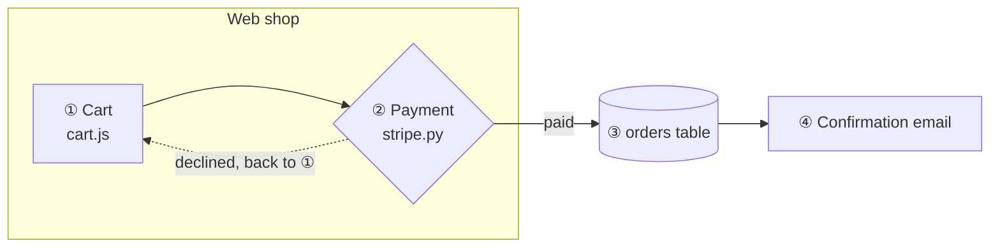

# Source file format for the Architecture Viewer

This spec describes the Markdown file that `index.html` reads (through `serve.py`, a file picker or drag and drop). It is written for people and for AI coding assistants who want to produce a compatible file.

**In one sentence:** one Markdown file holds a Mermaid **flowchart** and a Markdown **step table**. Each table row has a short **step key**, and the same key appears in the label of the diagram boxes that belong to that step.

---

## 1. File structure

A UTF-8 Markdown file (`.md`) that contains at least:

1. **A diagram:** a fenced code block with the info string `mermaid` that contains a `flowchart` (or `graph`) diagram.
2. **A step table:** a GitHub-flavoured Markdown table with one column of step keys.

Everything else in the file (prose, other tables, other code blocks) is allowed and ignored.

| Element | Used for |
|---|---|
| First `# H1` heading | Page title |
| Nearest heading above the diagram | Subtitle |
| Nearest heading above the step table | Title of the step list |

If the file contains several diagrams, the viewer opens the one whose step table matches best. It pairs each diagram with its own step table (section 4), so you choose only the diagram. A dropdown for that appears when more than one diagram has a matching table.

## 2. The diagram

- **Type:** `flowchart TD`, `flowchart LR` or `graph …`. Only flowcharts are supported, because the viewer reads the flowchart's node, edge and subgraph ids from the rendered SVG. Mermaid 11 does the rendering.
- **Nodes:** any flowchart shape (`A["…"]`, `A{"…"}`, `A[("…")]`, `A(["…"])` and so on). The node **id** (`A`) is what overrides refer to (section 5). Ids may contain letters, digits and `_`.
- **Subgraphs** (`subgraph E1["…"] … end`) become clickable groups. A node belongs to the smallest subgraph that contains it on screen.
- **Edges:** any arrow (`-->`, `-.->`, `==>`). Labels (`-- text -->` or `-->|text|`) are searched for step keys too. Dotted edges are treated as side paths.
- **Line breaks** in labels: use `<br/>`. The **first line** of a label is its name in the sidebar.

### Step keys inside the diagram

Put the step key in the label of every node (or edge) that **is** that step, usually at the start:

```
LAUNCH["⑧ launch_agent.py --launch"]
```

- A key matches only as a whole token. `⑫` does not match inside `⑫a`, and `1` does not match inside `10`.
- A range of circled numbers in a label, such as `④-⑧`, is read as `④ ⑤ ⑥ ⑦ ⑧`. That's useful for one edge that stands for several steps.
- A node may carry several keys (`"③ ④ check"`), and several nodes may share one key.

## 3. The step table

```markdown
| Step | Key | Environment | Command | … any further columns … |
|---|---|---|---|---|
| Request arrives | ① | E1 | `[Requester] …` | … |
```

- **Key column:** short values without spaces, at most 6 characters each. Examples: `①`, `⑫a`, `Ⓢ`, `3`, `3a`, `S2`. Circled numbers `⓪`-`⑳` are recommended, because they stand out in the diagram and can't be confused with numbers in ordinary text. The column can sit anywhere and have any header.
- **Name column:** the first column that isn't the key column. It's shown as the step title.
- **All other columns** are shown, under their header, in the detail panel of the selected step. Inline `code` and `**bold**` are rendered.
- **Row order is the step order** for Next, Back and Play. Keys may repeat: two rows with key `⑫` both highlight the `⑫` boxes.
- A `|` inside a cell must be inside backticks or escaped as `\|`.

## 4. How the table is matched to the diagram

For every combination of diagram, table and column, the viewer collects the cells that are valid keys (section 3) and also appear in the diagram source. The score is:

> **number of distinct matching keys × share of the table's rows that match**

The highest score wins, and **at least 2 distinct keys** must match. The one exception is a one-row table between the diagram and the next one: it is used when its single key appears in the diagram. Each diagram first scores only the tables **between it and the next diagram**. It considers the other tables only when none of those matches. So putting each step table right after its diagram is the simplest way to pair them. Real step keys are distinct, and almost every row matches. A column such as "Environment" repeats the same value (`E1`, `E1`, …) and matches only some rows, so it scores low even when `E1` appears in the diagram. If a file has several diagrams, each diagram picks its own best table when you switch to it, so give each diagram its own key set (for example ①-⑭ for one, Ⓐ Ⓑ Ⓒ for another).

## 5. What a step highlights

| Highlight | Colour in the UI | Elements |
|---|---|---|
| **Step** (primary) | Signal blue, animated edges | Nodes whose label contains the key. Nodes listed for the key in a `%% @step` override. Edges whose label contains the key. Edges between two step nodes. Edges from the previous step's nodes to this step's nodes. |
| **Touched** (secondary) | Green, dashed | Nodes one edge away (in or out) from a step node. The endpoints of edges labelled with the key. The subgraph around each step node. Nodes and subgraphs **mentioned** in the row's text (below). |

**A row mentions a node or subgraph when its text contains:**
- the node **id** as a whole word, case-sensitive and at least 2 characters (for example `E1`, `PR`)
- a file, path or endpoint token from the node's label (a word with `.` or `/`, such as `check_sender.py` or `/v1/agents`), as long as at most two nodes share that token. Bare folders ending in `/` (such as `src/`) don't count.
- the node's **short name**: the first label line, cut at `(`, `,` or `:`, between 4 and 30 characters and at most 3 words, matched as a whole phrase in any case (for example `Requester`)

**Clicking a node or subgraph** lists every step for which it is a step or touched element, and highlights those rows.

### Overrides

If the automatic linking misses something, add Mermaid comments. Mermaid ignores them, and the viewer reads them:

```
%% @step ⑨: API, AGENT
%% @step ⑫a: FOLLOW API
```

Syntax: `%% @step <key>: <node or subgraph id>, <id> …`, with ids separated by commas or spaces. Listed ids become **step** (primary) elements for that key. Unknown ids are ignored.

## 6. Overview mode

**Overview** (button in the top bar, or the `O` key) shows the big picture: one box per group, and one arrow per pair of groups that talk to each other. The viewer computes it from the detailed diagram, so it works without extra markup. The comment lines below make it presentation-ready.

### How the overview is built

| Detailed diagram | In the overview |
|---|---|
| A **top-level `subgraph`** (for example an environment, a service or a team) | **One box**: the group's title in bold, then its role (`@overview`), or by default its number of components and its step keys. A group with a single component shows that component's label. Nested subgraphs are folded into their top-level group. |
| A node **outside any subgraph** (people, external actors) | Unchanged, with its own shape and label |
| A node listed in **`@overview-keep`** | Stays visible inside its group, which is then drawn as a subgraph. The group's other nodes become one box with the role text. |
| **Arrows between two groups** (in the same direction) | **Merged into one arrow.** Its label lists the step keys that use the connection: the keys in each merged arrow's own label, or, if it has none, the key of the box the arrow leaves (inside a group) or enters. If only one arrow was merged, its own label is kept as well. Dashed only if all merged arrows were dashed. |
| Arrows **inside** a group | Hidden |

Steps keep working in the overview. A step highlights the boxes that contain its components and the merged arrows that carry its key. Clicking a box lists every step that touches any of its components, and **Show in detail** opens the detailed diagram at that group.

### Writing the diagram for a good overview

- Put every component inside a **top-level `subgraph`** that stands for one architectural element (environment, system, service). Leave only people and external actors outside.
- Give each group a **short title** in its label, for example `subgraph E1["E1 · Grok Bot VM"]`, or set one with `@overview` (below).
- Keep **ids** short and stable: the overview reuses them.

### Overview comment lines

Like `@step`, these are Mermaid comments. Mermaid ignores them, and only the viewer reads them. They can go anywhere in the diagram.

```
%% @overview E1: E1 · Grok Bot VM | bot/*.md instructions + src/ scripts<br/>🔒 G1-G9
%% @overview E5: Launch, follow-up, run status
%% @overview-keep E3: RECORD, PR, MAIN
%% @overview-direction TD
```

| Line | Effect |
|---|---|
| `%% @overview <group>: <role>` | Text under the group's title in the overview. `<br/>` makes a line break. |
| `%% @overview <group>: <title> \| <role>` | Also replaces the group's title in the overview (the part before ` \| `, with spaces around the bar). Use it when the detailed title is long. |
| `%% @overview-keep <group>: <id>, <id>` | These nodes stay visible inside the group, for elements that matter on their own (for example the system of record). |
| `%% @overview-direction LR` | Direction of the overview: `LR`, `RL`, `TD`, `TB` or `BT`. Without it, the viewer draws both `LR` and `TD` and keeps the one that fits the screen larger. |

`<group>` is a top-level subgraph id, and `<id>` a node id inside it. Unknown ids are ignored.

## 7. Pinned positions

```
%% @pos SECURITY_REVIEW: 812 455
```

`%% @pos <node>: <x> <y>` moves a node so that its centre is at that point, in the coordinates of the rendered diagram (the SVG's user space). Its arrows are then drawn as straight lines, and the subgraphs around it are resized to fit their nodes. Edit mode writes these lines when you drag a box, and you rarely need to write them by hand. Mermaid ignores them, so in other Markdown renderers the diagram keeps its automatic layout. Pins apply in Detail mode only: the Overview is always laid out automatically.

## 8. Files made in Edit mode

**A new sketch** is exported in this format:
- one diagram per board: As-is process, with keys Ⓐ Ⓑ Ⓒ, and Proposed architecture, with ① ② ③
- each diagram followed by its step table, with the key in the first column

Steps that have no box yet are listed in a `%% Steps without a box yet: …` comment, so the table still matches.

**An edited copy of a file** is that file's text, with each edited diagram and table changed in place. A diagram line keeps its exact text while nothing it defines has changed.

**At the end of the file**, either kind has:
- a `## Diffs` section listing every change in plain words
- the sketch itself, with its diff log, as JSON in an HTML comment:

```
<!-- architecture-viewer-sketch fnv=1a2b3c4d
{"v":2,"id":"…","title":"…","boards":{…},"log":{"base":{…},"entries":[…]}}
-->
```

- **`fnv`** is a fingerprint of everything above the comment. If the text no longer matches it, Edit asks whether to use the file as it is now or the stored sketch.
- **`log`** holds the first state and one patch per change, so the history can be replayed and any state restored.
- **Hidden:** Markdown renderers don't show the comment.
- **Removing it** is safe for viewing: the file still works in the viewer. **Edit** then treats it as an ordinary file and opens a copy, without the history.

## 9. Minimal example

````markdown
# Order flow

## Diagram



## Steps

| Step | # | Where | What happens |
|---|---|---|---|
| Add to cart | ① | WEB | `cart.js` stores the items |
| Pay | ② | WEB | `stripe.py` charges the card |
| Save order | ③ | DB | Row written to the orders table |
| Confirm | ④ | Mail | Email sent to the customer |
````

## 10. Checklist for authors and assistants

- [ ] Every `mermaid` flowchart that should be walked through has its step table right after it, before the next diagram.
- [ ] Every table row has a key, and that key appears in at least one node or edge label (or in a `%% @step` line).
- [ ] Keys are whole tokens: don't glue them to letters or digits unless that's the key itself (`⑫a`).
- [ ] No other table column contains short tokens that also appear in the diagram, or that column may be picked as the key column instead.
- [ ] Node ids that you want rows to mention (such as environments `E1`, `E2`) appear as whole words in the row text.
- [ ] For the overview: every component sits in a top-level `subgraph`, only people and external actors are outside, and each group has a short title or an `@overview` line.
- [ ] Elements that must stay visible in the overview are listed in `@overview-keep`.
- [ ] The diagram renders in Mermaid 11 (check it at mermaid.live). Syntax errors are shown in the viewer.
