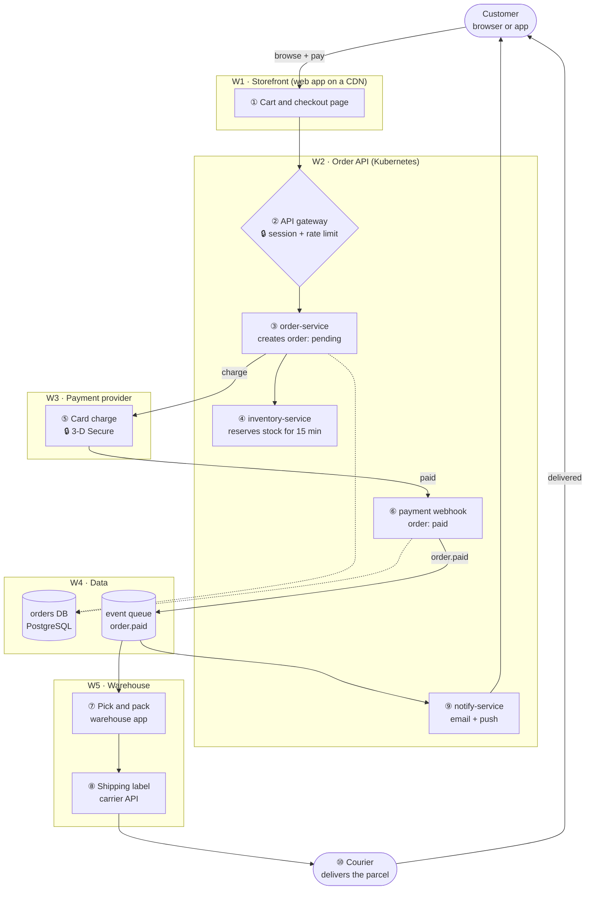

# Sample architecture: Bookstore order flow

A fictional online bookstore, from checkout to delivery. All names and services are made up. Use this file to try the viewer: `python3 serve.py sample_architecture.md --open`.

## Order flow diagram

Dashed arrows are writes to the orders database.

## Steps

| Step | # | Where | Who / what | What happens | Data written |
|---|---|---|---|---|---|
| Checkout | ① | W1 | Customer | Reviews the cart and clicks **Pay** | n/a |
| Authenticate | ② | W2 | API gateway | Checks the session token and the rate limit, and turns away bots | n/a |
| Create order | ③ | W2 → W4 | `order-service` | `POST /orders` creates the order with status `pending` | `orders` row |
| Reserve stock | ④ | W2 | `inventory-service` | Holds every item for 15 minutes, so it can't be sold twice | `reservations` rows |
| Charge card | ⑤ | W2 → W3 | Payment provider | Charges the card, with 3-D Secure when the bank asks for it | n/a |
| Payment confirmed | ⑥ | W3 → W2 → W4 | Webhook | The provider calls `/webhooks/payment`. The order becomes `paid`, and an `order.paid` event is published | `orders.status`, `order.paid` event |
| Pick and pack | ⑦ | W4 → W5 | Warehouse app | Picks the reserved items and packs the parcel | n/a |
| Ship | ⑧ | W5 | Carrier API | Buys a shipping label and hands the parcel to the courier | tracking number |
| Notify customer | ⑨ | W2 | `notify-service` | Sends the confirmation email and a push message with the tracking link | n/a |
| Deliver | ⑩ | Courier | Courier | Delivers the parcel to the customer | n/a |
