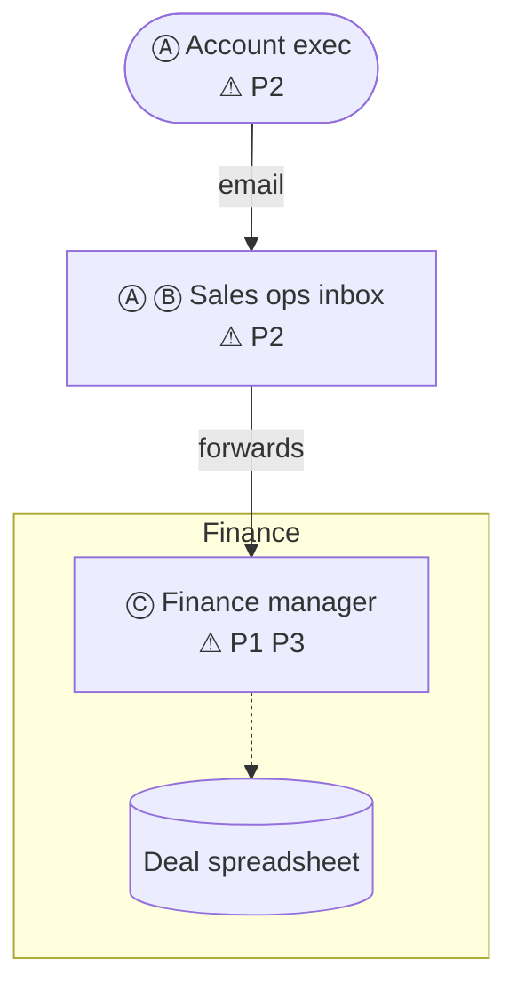
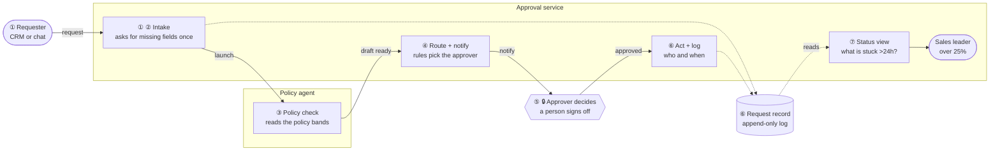

# Deal desk discount approval

Sketched in Architecture Viewer on 14 Oct 2026. All data is synthesized for the exercise.

## Technical discovery

### Use case

- **Use case:** Discount approval for deals above 15%
- **Line of business and team:** Sales and Finance
- **What starts it:** An account exec asks for a discount

### Quantification

- **Volume:** ~60 deals per month
- **Cycle time today:** 3-5 days
- **Rework and exception rate:** 1 in 3 requests needs a re-ask

### Definition of success

- **Success metric:** Hours from request to decision
- **Baseline:** 3-5 days
- **Target:** Same day, by the end of the pilot

## Pains

| Pain | # | Cost |
|---|---|---|
| Approvals sit in email threads | P1 | ~3 days per deal |
| Nobody knows the policy bands | P2 | 1 in 3 requests re-asked |
| No record of who approved | P3 | audit findings each quarter |

## As-is process

### As-is steps

| # | Step | Who | Tool | Wait | Pain |
|---|---|---|---|---|---|
| Ⓐ | AE emails the discount request | Account exec | Email |  | ⚠ P2 Nobody knows the policy bands |
| Ⓑ | Ops forwards to Finance | Sales ops | Shared inbox | 1 day |  |
| Ⓒ | Finance decides in the thread | Finance manager | Email, spreadsheet | 2-4 days | ⚠ P1 Approvals sit in email threads, ⚠ P3 No record of who approved |

## Proposed architecture

### Proposed steps

| # | Step | Owner | What happens | Removes |
|---|---|---|---|---|
| ① | Request arrives | Approval service | The account exec submits the deal in the CRM |  |
| ② | Ask once for what's missing | Approval service | Missing fields are asked for once, in one message |  |
| ③ | Check against the policy | Policy agent | The deal is checked against the policy bands | P2 Nobody knows the policy bands |
| ④ | Route and notify the approver | Approval service | The right approver is picked and notified | P1 Approvals sit in email threads |
| ⑤ | A person decides | Approver | The approver decides in the request |  |
| ⑥ | Act and log | Approval service | The decision is applied and logged with who and when | P3 No record of who approved |
| ⑦ | Status and exceptions | Approval service | Anything stuck for more than a day is flagged |  |

## Pain scorecard

| Pain | Fixed by | Measure |
|---|---|---|
| P1 Approvals sit in email threads | Step ④ Route and notify the approver | hours from request to decision |
| P2 Nobody knows the policy bands | Step ③ Check against the policy | re-asks per request |
| P3 No record of who approved | Step ⑥ Act and log | decisions with an approver and time |
<!-- architecture-viewer-sketch fnv=ac92d986
{"v":3,"id":"sdealdesk","title":"Deal desk discount approval","created":1791992072217,"updated":1791992089028,"notes":"","discovery":{"usecase.name":"Discount approval for deals above 15%","quant.volume":"~60 deals per month","usecase.lob":"Sales and Finance","usecase.trigger":"An account exec asks for a discount","quant.cycle":"3-5 days","quant.rework":"1 in 3 requests needs a re-ask","success.kpi":"Hours from request to decision","success.baseline":"3-5 days","success.target":"Same day, by the end of the pilot"},"pains":[{"id":"P1","text":"Approvals sit in email threads","cost":"~3 days per deal","measure":"hours from request to decision"},{"id":"P2","text":"Nobody knows the policy bands","cost":"1 in 3 requests re-asked","measure":"re-asks per request"},{"id":"P3","text":"No record of who approved","cost":"audit findings each quarter","measure":"decisions with an approver and time"}],"slots":["asis","tobe"],"boards":{"asis":{"kind":"native","dir":"AUTO","groups":[{"id":"gt9j5otgy","label":"Finance","parent":null,"mid":null,"raw":null,"dir":""}],"nodes":[{"id":"nt9d5yg5c","label":"Account exec","sub":"","shape":"person","group":null,"mid":null,"raw":null,"keys0":null,"br":null,"cls":""},{"id":"nt9d5jnik","label":"Sales ops inbox","sub":"","shape":"box","group":null,"mid":null,"raw":null,"keys0":null,"br":null,"cls":""},{"id":"nt9j5hsro","label":"Finance manager","sub":"","shape":"box","group":"gt9j5otgy","mid":null,"raw":null,"keys0":null,"br":null,"cls":""},{"id":"nt9ogpvd2","label":"Deal spreadsheet","sub":"","shape":"store","group":"gt9j5otgy","mid":null,"raw":null,"keys0":null,"br":null,"cls":""}],"edges":[{"id":"et9d5kzeu","from":"nt9d5yg5c","to":"nt9d5jnik","label":"email","dashed":false,"arrow":null,"labelRaw":null},{"id":"et9j5hma5","from":"nt9d5jnik","to":"nt9j5hsro","label":"forwards","dashed":false,"arrow":null,"labelRaw":null},{"id":"et9og4m0t","from":"nt9j5hsro","to":"nt9ogpvd2","label":"","dashed":true,"arrow":null,"labelRaw":null}],"steps":[{"id":"ttaugns4g","name":"AE emails the discount request","who":"Account exec","tool":"Email","wait":"","what":"","owner":"","pains":["P2"],"nodes":["nt9d5yg5c","nt9d5jnik"]},{"id":"ttavn75ov","name":"Ops forwards to Finance","who":"Sales ops","tool":"Shared inbox","wait":"1 day","what":"","owner":"","pains":[],"nodes":["nt9d5jnik"]},{"id":"ttaynh9mv","name":"Finance decides in the thread","who":"Finance manager","tool":"Email, spreadsheet","wait":"2-4 days","what":"","owner":"","pains":["P1","P3"],"nodes":["nt9j5hsro"]}],"pos":{}},"tobe":{"kind":"native","dir":"AUTO","groups":[{"id":"gtg8xlcdk","label":"Approval service","parent":null,"mid":null,"raw":null,"dir":""},{"id":"gtg8xxfq2","label":"Policy agent","parent":null,"mid":null,"raw":null,"dir":""}],"nodes":[{"id":"ntg8xzj95","label":"Requester","sub":"CRM or chat","shape":"person","group":null,"mid":null,"raw":null,"keys0":null,"br":null,"cls":""},{"id":"ntg8x13as","label":"Intake","sub":"asks for missing fields once","shape":"box","group":"gtg8xlcdk","mid":null,"raw":null,"keys0":null,"br":null,"cls":""},{"id":"ntg8x547g","label":"Policy check","sub":"reads the policy bands","shape":"box","group":"gtg8xxfq2","mid":null,"raw":null,"keys0":null,"br":null,"cls":""},{"id":"ntg8xfdyw","label":"Route + notify","sub":"rules pick the approver","shape":"box","group":"gtg8xlcdk","mid":null,"raw":null,"keys0":null,"br":null,"cls":""},{"id":"ntg8xr84k","label":"Approver decides","sub":"a person signs off","shape":"gate","group":null,"mid":null,"raw":null,"keys0":null,"br":null,"cls":""},{"id":"ntg8xvlts","label":"Act + log","sub":"who and when","shape":"box","group":"gtg8xlcdk","mid":null,"raw":null,"keys0":null,"br":null,"cls":""},{"id":"ntg8xunkc","label":"Status view","sub":"what is stuck >24h?","shape":"box","group":"gtg8xlcdk","mid":null,"raw":null,"keys0":null,"br":null,"cls":""},{"id":"ntg8xddhv","label":"Request record","sub":"append-only log","shape":"store","group":null,"mid":null,"raw":null,"keys0":null,"br":null,"cls":""},{"id":"ntibwmej9","label":"Sales leader","sub":"over 25%","shape":"person","group":"gtg8xlcdk","mid":null,"raw":null,"keys0":null,"br":null,"cls":""}],"edges":[{"id":"etg8xzl9y","from":"ntg8xzj95","to":"ntg8x13as","label":"request","dashed":false,"arrow":null,"labelRaw":null},{"id":"etg8xo3eb","from":"ntg8x13as","to":"ntg8x547g","label":"launch","dashed":false,"arrow":null,"labelRaw":null},{"id":"etg8xmoz8","from":"ntg8x547g","to":"ntg8xfdyw","label":"draft ready","dashed":false,"arrow":null,"labelRaw":null},{"id":"etg8x9x58","from":"ntg8xfdyw","to":"ntg8xr84k","label":"notify","dashed":false,"arrow":null,"labelRaw":null},{"id":"etg8x56it","from":"ntg8xr84k","to":"ntg8xvlts","label":"approved","dashed":false,"arrow":null,"labelRaw":null},{"id":"etg8x8vz8","from":"ntg8x13as","to":"ntg8xddhv","label":"","dashed":true,"arrow":null,"labelRaw":null},{"id":"etg8xdn7p","from":"ntg8xvlts","to":"ntg8xddhv","label":"","dashed":true,"arrow":null,"labelRaw":null},{"id":"etg8xaplp","from":"ntg8xddhv","to":"ntg8xunkc","label":"reads","dashed":true,"arrow":null,"labelRaw":null},{"id":"etibworad","from":"ntg8xunkc","to":"ntibwmej9","label":"","dashed":false,"arrow":null,"labelRaw":null}],"steps":[{"id":"ttg8x1w0l","name":"Request arrives","who":"","tool":"","wait":"","what":"The account exec submits the deal in the CRM","owner":"Approval service","pains":[],"nodes":["ntg8xzj95","ntg8x13as"]},{"id":"ttg8x2gro","name":"Ask once for what's missing","who":"","tool":"","wait":"","what":"Missing fields are asked for once, in one message","owner":"Approval service","pains":[],"nodes":["ntg8x13as"]},{"id":"ttg8xxv10","name":"Check against the policy","who":"","tool":"","wait":"","what":"The deal is checked against the policy bands","owner":"Policy agent","pains":["P2"],"nodes":["ntg8x547g"]},{"id":"ttg8xqtom","name":"Route and notify the approver","who":"","tool":"","wait":"","what":"The right approver is picked and notified","owner":"Approval service","pains":["P1"],"nodes":["ntg8xfdyw"]},{"id":"ttg8xy8u7","name":"A person decides","who":"","tool":"","wait":"","what":"The approver decides in the request","owner":"Approver","pains":[],"nodes":["ntg8xr84k"]},{"id":"ttg8xis4d","name":"Act and log","who":"","tool":"","wait":"","what":"The decision is applied and logged with who and when","owner":"Approval service","pains":["P3"],"nodes":["ntg8xvlts","ntg8xddhv"]},{"id":"ttg8xudl9","name":"Status and exceptions","who":"","tool":"","wait":"","what":"Anything stuck for more than a day is flagged","owner":"Approval service","pains":[],"nodes":["ntg8xunkc"]}],"pos":{}}},"source":null,"log":{"base":{"v":3,"id":"sdealdesk","title":"Deal desk discount approval","created":1791992072217,"updated":1791992089028,"notes":"","discovery":{"usecase.name":"Discount approval for deals above 15%","quant.volume":"~60 deals per month","usecase.lob":"Sales and Finance","usecase.trigger":"An account exec asks for a discount","quant.cycle":"3-5 days","quant.rework":"1 in 3 requests needs a re-ask","success.kpi":"Hours from request to decision","success.baseline":"3-5 days","success.target":"Same day, by the end of the pilot"},"pains":[{"id":"P1","text":"Approvals sit in email threads","cost":"~3 days per deal","measure":"hours from request to decision"},{"id":"P2","text":"Nobody knows the policy bands","cost":"1 in 3 requests re-asked","measure":"re-asks per request"},{"id":"P3","text":"No record of who approved","cost":"audit findings each quarter","measure":"decisions with an approver and time"}],"slots":["asis","tobe"],"boards":{"asis":{"kind":"native","dir":"AUTO","groups":[{"id":"gt9j5otgy","label":"Finance","parent":null,"mid":null,"raw":null,"dir":""}],"nodes":[{"id":"nt9d5yg5c","label":"Account exec","sub":"","shape":"person","group":null,"mid":null,"raw":null,"keys0":null,"br":null,"cls":""},{"id":"nt9d5jnik","label":"Sales ops inbox","sub":"","shape":"box","group":null,"mid":null,"raw":null,"keys0":null,"br":null,"cls":""},{"id":"nt9j5hsro","label":"Finance manager","sub":"","shape":"box","group":"gt9j5otgy","mid":null,"raw":null,"keys0":null,"br":null,"cls":""},{"id":"nt9ogpvd2","label":"Deal spreadsheet","sub":"","shape":"store","group":"gt9j5otgy","mid":null,"raw":null,"keys0":null,"br":null,"cls":""}],"edges":[{"id":"et9d5kzeu","from":"nt9d5yg5c","to":"nt9d5jnik","label":"email","dashed":false,"arrow":null,"labelRaw":null},{"id":"et9j5hma5","from":"nt9d5jnik","to":"nt9j5hsro","label":"forwards","dashed":false,"arrow":null,"labelRaw":null},{"id":"et9og4m0t","from":"nt9j5hsro","to":"nt9ogpvd2","label":"","dashed":true,"arrow":null,"labelRaw":null}],"steps":[{"id":"ttaugns4g","name":"AE emails the discount request","who":"Account exec","tool":"Email","wait":"","what":"","owner":"","pains":["P2"],"nodes":["nt9d5yg5c","nt9d5jnik"]},{"id":"ttavn75ov","name":"Ops forwards to Finance","who":"Sales ops","tool":"Shared inbox","wait":"1 day","what":"","owner":"","pains":[],"nodes":["nt9d5jnik"]},{"id":"ttaynh9mv","name":"Finance decides in the thread","who":"Finance manager","tool":"Email, spreadsheet","wait":"2-4 days","what":"","owner":"","pains":["P1","P3"],"nodes":["nt9j5hsro"]}],"pos":{}},"tobe":{"kind":"native","dir":"AUTO","groups":[{"id":"gtg8xlcdk","label":"Approval service","parent":null,"mid":null,"raw":null,"dir":""},{"id":"gtg8xxfq2","label":"Policy agent","parent":null,"mid":null,"raw":null,"dir":""}],"nodes":[{"id":"ntg8xzj95","label":"Requester","sub":"CRM or chat","shape":"person","group":null,"mid":null,"raw":null,"keys0":null,"br":null,"cls":""},{"id":"ntg8x13as","label":"Intake","sub":"asks for missing fields once","shape":"box","group":"gtg8xlcdk","mid":null,"raw":null,"keys0":null,"br":null,"cls":""},{"id":"ntg8x547g","label":"Policy check","sub":"reads the policy bands","shape":"box","group":"gtg8xxfq2","mid":null,"raw":null,"keys0":null,"br":null,"cls":""},{"id":"ntg8xfdyw","label":"Route + notify","sub":"rules pick the approver","shape":"box","group":"gtg8xlcdk","mid":null,"raw":null,"keys0":null,"br":null,"cls":""},{"id":"ntg8xr84k","label":"Approver decides","sub":"a person signs off","shape":"gate","group":null,"mid":null,"raw":null,"keys0":null,"br":null,"cls":""},{"id":"ntg8xvlts","label":"Act + log","sub":"who and when","shape":"box","group":"gtg8xlcdk","mid":null,"raw":null,"keys0":null,"br":null,"cls":""},{"id":"ntg8xunkc","label":"Status view","sub":"what is stuck >24h?","shape":"box","group":"gtg8xlcdk","mid":null,"raw":null,"keys0":null,"br":null,"cls":""},{"id":"ntg8xddhv","label":"Request record","sub":"append-only log","shape":"store","group":null,"mid":null,"raw":null,"keys0":null,"br":null,"cls":""},{"id":"ntibwmej9","label":"Sales leader","sub":"over 25%","shape":"person","group":"gtg8xlcdk","mid":null,"raw":null,"keys0":null,"br":null,"cls":""}],"edges":[{"id":"etg8xzl9y","from":"ntg8xzj95","to":"ntg8x13as","label":"request","dashed":false,"arrow":null,"labelRaw":null},{"id":"etg8xo3eb","from":"ntg8x13as","to":"ntg8x547g","label":"launch","dashed":false,"arrow":null,"labelRaw":null},{"id":"etg8xmoz8","from":"ntg8x547g","to":"ntg8xfdyw","label":"draft ready","dashed":false,"arrow":null,"labelRaw":null},{"id":"etg8x9x58","from":"ntg8xfdyw","to":"ntg8xr84k","label":"notify","dashed":false,"arrow":null,"labelRaw":null},{"id":"etg8x56it","from":"ntg8xr84k","to":"ntg8xvlts","label":"approved","dashed":false,"arrow":null,"labelRaw":null},{"id":"etg8x8vz8","from":"ntg8x13as","to":"ntg8xddhv","label":"","dashed":true,"arrow":null,"labelRaw":null},{"id":"etg8xdn7p","from":"ntg8xvlts","to":"ntg8xddhv","label":"","dashed":true,"arrow":null,"labelRaw":null},{"id":"etg8xaplp","from":"ntg8xddhv","to":"ntg8xunkc","label":"reads","dashed":true,"arrow":null,"labelRaw":null},{"id":"etibworad","from":"ntg8xunkc","to":"ntibwmej9","label":"","dashed":false,"arrow":null,"labelRaw":null}],"steps":[{"id":"ttg8x1w0l","name":"Request arrives","who":"","tool":"","wait":"","what":"The account exec submits the deal in the CRM","owner":"Approval service","pains":[],"nodes":["ntg8xzj95","ntg8x13as"]},{"id":"ttg8x2gro","name":"Ask once for what's missing","who":"","tool":"","wait":"","what":"Missing fields are asked for once, in one message","owner":"Approval service","pains":[],"nodes":["ntg8x13as"]},{"id":"ttg8xxv10","name":"Check against the policy","who":"","tool":"","wait":"","what":"The deal is checked against the policy bands","owner":"Policy agent","pains":["P2"],"nodes":["ntg8x547g"]},{"id":"ttg8xqtom","name":"Route and notify the approver","who":"","tool":"","wait":"","what":"The right approver is picked and notified","owner":"Approval service","pains":["P1"],"nodes":["ntg8xfdyw"]},{"id":"ttg8xy8u7","name":"A person decides","who":"","tool":"","wait":"","what":"The approver decides in the request","owner":"Approver","pains":[],"nodes":["ntg8xr84k"]},{"id":"ttg8xis4d","name":"Act and log","who":"","tool":"","wait":"","what":"The decision is applied and logged with who and when","owner":"Approval service","pains":["P3"],"nodes":["ntg8xvlts","ntg8xddhv"]},{"id":"ttg8xudl9","name":"Status and exceptions","who":"","tool":"","wait":"","what":"Anything stuck for more than a day is flagged","owner":"Approval service","pains":[],"nodes":["ntg8xunkc"]}],"pos":{}}},"source":null},"start":"History starts here","entries":[]}}
-->
